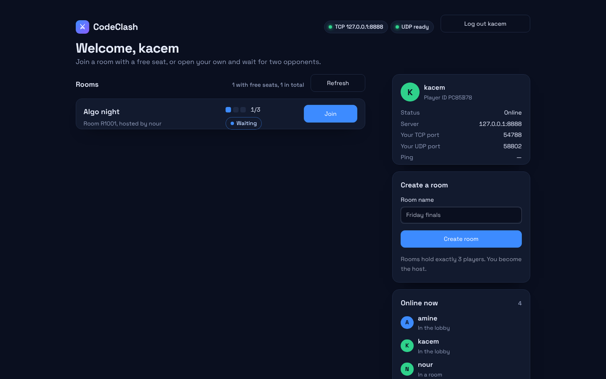
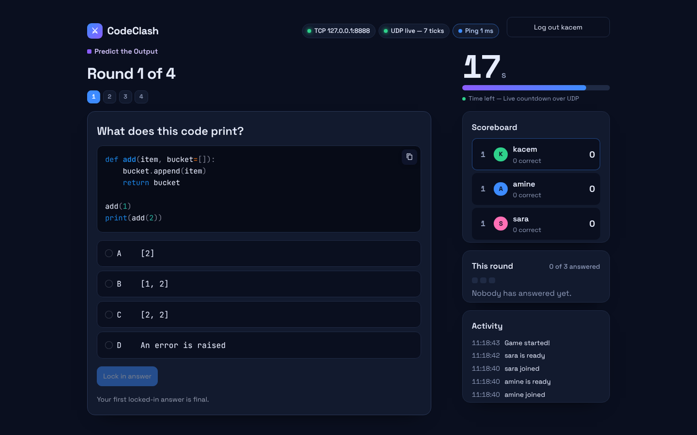
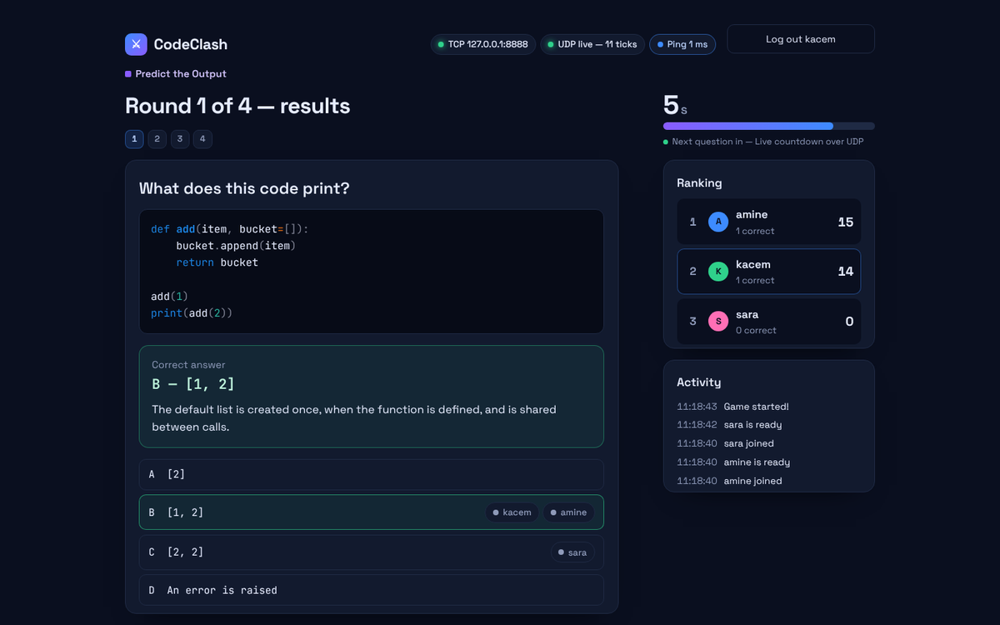
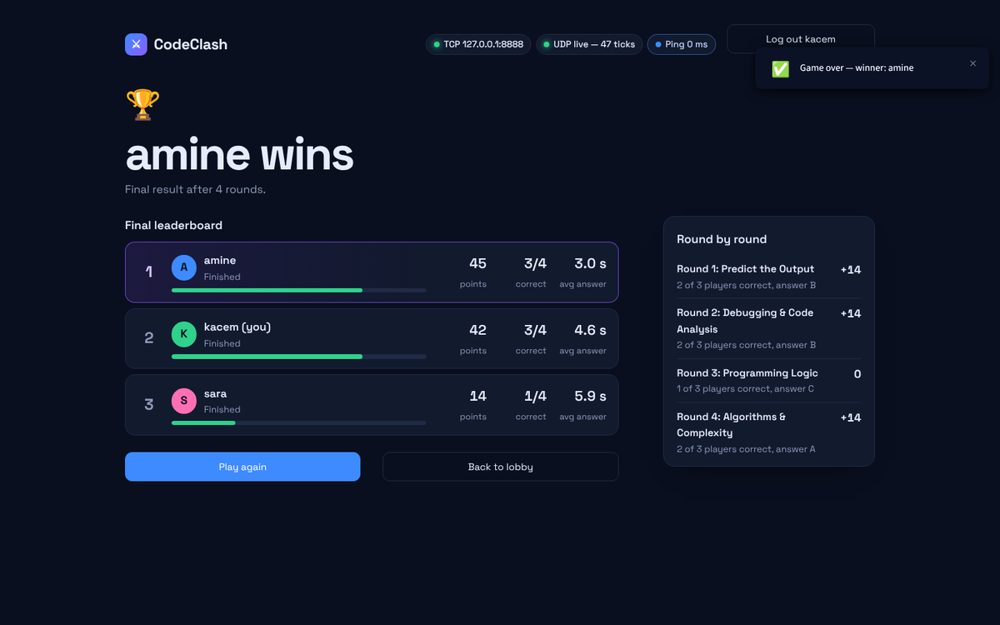

# CodeClash

A real-time multiplayer programming duel for three players, built for a Computer Networks course.
One computer runs the game server; three others run the player app. Everyone gets the same
question at the same moment (predict the output, programming logic, algorithms, debugging).
The server checks the answers, scores them, ranks the players and announces the winner.

Everything travels over real sockets between real computers:

* **TCP** (`AF_INET`, `SOCK_STREAM`) carries every important message: accounts, rooms, questions, answers, scores, results.
* **UDP** (`AF_INET`, `SOCK_DGRAM`) carries the live countdown, once per second, at the same time.
* **Threads**: the server gives every connected player a dedicated handler thread. Three players means three handler threads.

| Lobby | Game arena |
|---|---|
|  |  |
| **Round results** | **Final results** |
|  |  |

---

## Contents

1. [Technologies](#1-technologies)
2. [Architecture](#2-architecture)
3. [TCP vs UDP](#3-tcp-vs-udp)
4. [Threading](#4-threading)
5. [Project structure](#5-project-structure)
6. [Set up the server (MacBook)](#6-set-up-the-server-macbook)
7. [Set up a player computer (Windows)](#7-set-up-a-player-computer-windows)
8. [Configure the server IP](#8-configure-the-server-ip)
9. [Play a game](#9-play-a-game)
10. [Test with three computers](#10-test-with-three-computers)
11. [Automated tests](#11-automated-tests)
12. [Run from VS Code](#12-run-from-vs-code)
13. [Configuration reference](#13-configuration-reference)
14. [Common errors and solutions](#14-common-errors-and-solutions)
15. [Later: playing across networks](#15-later-playing-across-networks)

The full design (message formats, game rules, locking rules) is in [docs/ARCHITECTURE.md](docs/ARCHITECTURE.md).
The complete test plan and demo run sheet are in [docs/TESTING.md](docs/TESTING.md).

---

## 1. Technologies

* Python 3.11+ (3.10 works too)
* Standard library only on the server: `socket`, `threading`, `queue`, `json`, `hashlib`, `hmac`
* Streamlit (the only third-party package), for the player interface
* JSON messages: newline-delimited over TCP, one object per datagram over UDP
* Passwords: PBKDF2-HMAC-SHA256 with a random salt per user (never stored in plain text)

## 2. Architecture

```
            Same Wi-Fi router / LAN
 ┌────────────────────────────────────────────────────────────────────┐
 │  MacBook — SERVER   python3 -m server.main_server                  │
 │     TCP 0.0.0.0:8888   (one persistent connection per player)      │
 │     UDP 0.0.0.0:8888   (HELLO in, TIMER_TICK out)                  │
 │        ▲ TCP+UDP            ▲ TCP+UDP             ▲ TCP+UDP         │
 │  Windows PC 1          Windows PC 2          Windows PC 3          │
 │  streamlit run app.py  streamlit run app.py  streamlit run app.py  │
 │  browser: localhost:8501 (the UI stays on that computer)           │
 └────────────────────────────────────────────────────────────────────┘
```

* The **server is authoritative**. It picks the questions, keeps the clock, receives the answers,
  decides what is correct and computes every score. Clients never receive the answer key.
* Each player app keeps **one TCP connection** open for the whole session, plus one UDP socket.
* The interface shows a mirror of what the server reports, so all three screens move from
  question to results to final standings together.

## 3. TCP vs UDP

| What | Protocol | Why |
|---|---|---|
| Register, log in, rooms, ready, start | TCP | Must arrive once, in order |
| Question (round start) and round results (round end) | TCP | Authoritative events every player must get |
| Answer submission and its acknowledgement | TCP | An answer can never be lost or counted twice |
| Scores, rankings, winner, player status | TCP | Players need the official result |
| Heartbeat ping | TCP | Detects a dead connection (Wi-Fi drop, laptop sleep) |
| Countdown, every second | UDP | Small and time-sensitive; a lost tick is replaced 1 s later |
| "2 of 3 players answered" | UDP | Nice-to-have live information |
| UDP hello / ack | UDP | Registers the player's UDP address; the UI shows "UDP live" |

If UDP is blocked, the game still works: the countdown is estimated locally, and the UI says so.

## 4. Threading

**Server (MacBook)** — type `threads` in the server console to see them live:

| Thread | How many | Job |
|---|---|---|
| `MainThread` | 1 | starts TCP and UDP together, admin console, clean shutdown |
| `tcp-accept` | 1 | accepts connections and creates a session for each one |
| `player-handler-<name>` | **1 per player (3 in a game)** | reads that player's TCP messages, processes requests, detects disconnection |
| `player-sender-<name>` | 1 per player | the only writer on that socket, so a frozen client never blocks anyone else |
| `udp-receiver` | 1 | receives UDP hellos and records each player's UDP address |
| `game-<room>` | 1 per running game | opens rounds, sends the countdown, closes rounds, scores |

One `threading.Lock` protects the shared game state. Socket I/O never happens while it is held.
Answers are timestamped by the server the moment they arrive. Points are computed once per round,
by the game thread only, so simultaneous or repeated submissions can never add points twice.

**Client (each Windows PC):** `net-tcp-receiver`, `net-udp-receiver`, `net-heartbeat`, plus Streamlit's own.

## 5. Project structure

```
CodeClash/
├── app.py                 Streamlit player app (entry point on the Windows PCs)
├── config.py              ports, timings, scoring, server-IP lookup
├── start_server.sh        start the server on the MacBook
├── start_client.bat       start the player app on Windows (double-click)
├── start_client.sh        start the player app from Git Bash
├── requirements.txt       streamlit
├── common/protocol.py     message types, JSON envelopes, TCP framing, UDP packets, error codes
├── server/                runs on the MacBook only
│   ├── main_server.py     starts TCP + UDP, admin console
│   ├── tcp_server.py      listening socket + accept loop
│   ├── udp_server.py      UDP socket, receiver thread, endpoint registry
│   ├── player_handler.py  per-player handler + sender threads, request dispatch
│   ├── server_state.py    shared state and its lock
│   ├── auth_manager.py    accounts, PBKDF2 password hashing (server/data/users.json)
│   ├── room_manager.py    rooms, host, ready flags, leave/disconnect rules
│   ├── game_manager.py    rounds, countdown, answer checking, scoring, ranking
│   └── questions.py       35 questions with the answer key
├── client/                used by the player app
│   ├── tcp_client.py      persistent TCP connection + receiver thread
│   ├── udp_client.py      UDP socket + receiver thread
│   └── network_manager.py requests/responses, mirrored server state, heartbeat, reconnect
├── ui/                    the six pages + theme
├── static/fonts/          bundled fonts (works without internet)
├── tools/net_check.py     4-computer TCP + UDP connectivity check
├── tests/                 automated tests + headless test bot
└── docs/                  ARCHITECTURE.md, TESTING.md, screenshots
```

---

## 6. Set up the server (MacBook)

Do this on the MacBook. Use **Terminal.app**, not VS Code's terminal (see step 4).

**1. Check Python** (3.11 or newer):
```bash
python3 --version
```
If it is older or missing, install Python from <https://www.python.org/downloads/>.

**2. Get the project.** Unzip it and move the `CodeClash` folder to Downloads:
```bash
cd ~/Downloads/CodeClash
```
The server needs **no packages**. A virtual environment is optional; if you want one:
```bash
python3 -m venv venv
source venv/bin/activate
```

**3. Find the MacBook's IP address** (send it to your teammates):
```bash
ipconfig getifaddr en0          # e.g. 192.168.1.25
```
The server also prints it when it starts.

**4. Allow incoming connections.**
* **Firewall:** in System Settings → Network → Firewall, if the firewall is on, click **Allow** when
  macOS asks whether Python may accept incoming connections. Make sure "Block all incoming
  connections" is off. To approve Python in advance:
  ```bash
  PY="$(python3 -c 'import os,sys; print(os.path.realpath(sys.executable))')"
  sudo /usr/libexec/ApplicationFirewall/socketfilterfw --add "$PY"
  sudo /usr/libexec/ApplicationFirewall/socketfilterfw --unblockapp "$PY"
  ```
* **Local Network permission (macOS 15 and later):** programs started from Terminal.app are not
  affected. VS Code can be. If the server log shows `No route to host` when it sends UDP, allow
  VS Code in System Settings → Privacy & Security → Local Network, or use Terminal.app.

**5. Start the server:**
```bash
bash start_server.sh                           # 8 rounds of 20 s
CODECLASH_TOTAL_ROUNDS=4 bash start_server.sh  # shorter demo game
```
(equivalent: `python3 -m server.main_server`). You should see:
```
 CodeClash server running
   TCP  0.0.0.0:8888  (SOCK_STREAM)   UDP  0.0.0.0:8888  (SOCK_DGRAM)
   Clients connect to: 192.168.1.25
```

**6. Admin console.** Type these at the `codeclash>` prompt while the server runs:

| Command | Shows |
|---|---|
| `threads` | every live thread, including one `player-handler-<name>` per connected player |
| `players` | each logged-in player with their TCP and UDP addresses |
| `rooms` | rooms, members, host, ready flags, current round |
| `status` | connection counts and UDP packet counters |
| `kick <username>` | closes that player's connection (a disconnection test) |
| `quit` | stops the server cleanly (Ctrl+C works too) |

**7. During the demo:** keep the charger plugged in and the lid open, and run `caffeinate -dims` in a
second Terminal tab so the Mac does not sleep. If it sleeps, every player disconnects.

## 7. Set up a player computer (Windows)

Do this on each of the three Windows laptops.

**1. Install Python 3.11+** from <https://www.python.org/downloads/>. During installation, tick
**"Add python.exe to PATH"**. Check it:
```powershell
py --version
```

**2. Get the project.** Right-click the zip → Extract All. Windows often creates a folder inside a
folder: use the **inner** `CodeClash` folder, the one that contains `app.py`.

**3. Start the app. Easiest: double-click `start_client.bat`.** The first time, it creates a
virtual environment and installs Streamlit (needs internet once, about a minute). Then it opens
<http://localhost:8501> in the browser. Later runs start in a few seconds and work offline.

<details>
<summary><b>Or start it by hand: Git Bash</b></summary>

```bash
cd ~/Downloads/CodeClash
python -m venv venv
source venv/Scripts/activate
python -m pip install -r requirements.txt
python -m streamlit run app.py
```
Next time: `source venv/Scripts/activate` then `python -m streamlit run app.py`
(or simply `bash start_client.sh`). Open <http://localhost:8501> in the browser.
</details>

<details>
<summary><b>Or start it by hand: PowerShell</b></summary>

```powershell
cd $HOME\Downloads\CodeClash
python -m venv venv
.\venv\Scripts\Activate.ps1
python -m pip install -r requirements.txt
python -m streamlit run app.py
```
If PowerShell refuses to run `Activate.ps1`:
`Set-ExecutionPolicy -Scope Process -ExecutionPolicy Bypass`, then activate again.
Open <http://localhost:8501> in the browser.
</details>

**4. Windows firewall.**
* Set the Wi-Fi network to **Private**: Settings → Network & Internet → Wi-Fi → the network → Private.
* When Windows Defender Firewall asks about Python, allow it on **Private networks**.
* Normally nothing else is needed: the app sends UDP first, so the countdown comes back as a reply.
  If `net_check` (section 10) shows TCP passing but UDP failing while the Mac's firewall is fine, open
  a fixed UDP port. In an **admin** PowerShell:
  ```powershell
  New-NetFirewallRule -DisplayName "CodeClash client UDP 8889" -Direction Inbound -Protocol UDP -LocalPort 8889 -Action Allow -Profile Private
  ```
  Then start the app with that port: `$env:CODECLASH_CLIENT_UDP_PORT = "8889"` (PowerShell) or
  `export CODECLASH_CLIENT_UDP_PORT=8889` (Git Bash) in the same terminal, before `streamlit run`.

The player app only listens on `127.0.0.1:8501`: other computers cannot open it, only the server's
port 8888 is used across the network.

## 8. Configure the server IP

The simplest way is the first screen of the app. Type the MacBook's IP (for example
`192.168.1.25`) and click **Connect**. The app remembers it in `client_settings.json`.

Other ways, in order of priority:

| Method | Example |
|---|---|
| Environment variable (Git Bash) | `export CODECLASH_SERVER_HOST=192.168.1.25` |
| Environment variable (PowerShell) | `$env:CODECLASH_SERVER_HOST = "192.168.1.25"` |
| Saved by the connect screen | `client_settings.json` in the project folder |
| Default in code | `DEFAULT_SERVER_HOST` in `config.py` |

The server always binds `0.0.0.0` (`SERVER_BIND_HOST`), meaning every network interface of the
MacBook. Clients refuse `0.0.0.0`, `localhost` and `127.x`, because those would point at the client
computer itself. For development on one machine only, set `CODECLASH_ALLOW_LOOPBACK=1`.

## 9. Play a game

1. **Server:** start it on the MacBook (`bash start_server.sh`).
2. **Each player:** start the app, type the MacBook's IP, **Connect**, then **Create account and log in**
   (or **Log in** next time). The top bar shows `TCP …` and `UDP ready` in green.
3. **One player** creates a room in the lobby and becomes the **host**.
4. **The other two** click **Join** on that room, then **I'm ready**.
5. **The host** clicks **Start game** (it only works with three players and the other two ready).
6. **Each round:** read the code, pick an answer and click **Lock in answer** before the countdown
   ends. Your first locked-in answer is final. Correct = 10 points, plus up to 5 for speed.
7. **After each round,** everyone sees the correct answer, who picked what, the points and the ranking.
8. **After the last round,** the winner and final leaderboard appear. The host can click
   **Play again**; anyone can go **Back to lobby**.

If a player's connection drops, the others see it and keep playing. The player can click
**Reconnect** (or log in again) to rejoin the same game. If fewer than two players remain
connected, the game ends.

## 10. Test with three computers

Full checklist: [docs/TESTING.md](docs/TESTING.md). The short version:

**Step 1 — network check** (before anything else). On the Mac:
```bash
python3 tools/net_check.py server
```
On each PC, within the same minute:
```bash
python tools/net_check.py client --host 192.168.1.25 --name PC1 --hold 60
```
Every PC must print `TCP PASS | framing PASS | UDP PASS`, and the Mac must show
`active TCP handler threads: 3`. Stop it with Ctrl+C: the game server needs port 8888.

**Step 2 — a real game.** Start the server, start the app on the three PCs, play (section 9).
While it runs, type `threads` and `players` in the server console.

**Step 3 — disconnection.** During a round, close one PC's app window (or type `kick <name>` on the
server). The server logs the disconnection and keeps running, the other two see "lost connection"
and keep playing. Start the app again on that PC, log in, and it rejoins the game.

## 11. Automated tests

From the project folder (Mac: `python3`; Windows: `python`). The tests start their own server on a
free port of the same computer, so you can run them anywhere.

```bash
python3 -m unittest -v tests.test_protocol tests.test_questions          # 1 s
python3 -m unittest -v tests.test_server_integration                     # ~1 min, real server process
python3 -m unittest -v tests.test_network_manager                        # client networking, real server
python3 -m unittest -v tests.test_ui_app                                 # the Streamlit app, full game (needs streamlit)
```

| Suite | Proves |
|---|---|
| `test_protocol` | TCP framing survives split/merged packets, UTF-8, code with newlines; address guard |
| `test_questions` | runs every code snippet to prove the answer key is right |
| `test_server_integration` | auth, room rules, simultaneous and duplicate submissions, late answers, crash + reconnect, heartbeat timeout, 3 bot **processes** playing a match |
| `test_network_manager` | the client's TCP/UDP layer: errors, login, UDP handshake, full game, lost connection + Reconnect |
| `test_ui_app` | the real app: connect, register, lobby, room, every round, results, final, Play Again |

Before the UI was used, the backend was also tested with headless bots, one per computer:
```bash
python -m tests.bot_client --host 192.168.1.25 --user pc1 --create Finals      # PC 1
python -m tests.bot_client --host 192.168.1.25 --user pc2 --join auto          # PC 2, PC 3
```

## 12. Run from VS Code

Open the `CodeClash` folder, select the venv's Python as the interpreter (Ctrl+Shift+P →
"Python: Select Interpreter"), then go to Run and Debug (Ctrl+Shift+D) and pick:

* **CodeClash server (MacBook)**: runs `server.main_server`
* **CodeClash player app (Streamlit)**: runs the app; open <http://localhost:8501>
* **CodeClash tests (all)**

On the Mac, the server is safest in Terminal.app because of the Local Network permission
(section 6, step 4).

## 13. Configuration reference

Edit `config.py`, or set these environment variables before starting:

| Variable | Default | Meaning |
|---|---|---|
| `CODECLASH_SERVER_HOST` | — | MacBook IP the player app connects to |
| `CODECLASH_TCP_PORT` / `CODECLASH_UDP_PORT` | 8888 | server ports |
| `CODECLASH_CLIENT_UDP_PORT` | 0 (OS picks) | fixed client UDP port for a firewall rule |
| `CODECLASH_TOTAL_ROUNDS` | 8 | rounds per game (2 per category) |
| `CODECLASH_ROUND_DURATION_S` | 20 | seconds to answer |
| `CODECLASH_RESULTS_DURATION_S` | 6 | seconds on the round-results screen |
| `CODECLASH_PRE_GAME_COUNTDOWN_S` | 3 | "get ready" countdown |
| `CODECLASH_HEARTBEAT_TIMEOUT_S` | 15 | silent connection is dropped after this |
| `CODECLASH_ALLOW_LOOPBACK` | 0 | `1` lets a client use 127.0.0.1 (one-computer development only) |
| `CODECLASH_LOG_LEVEL` | INFO | `DEBUG` for more detail |

Scoring (in `config.py`): 10 points for a correct answer plus a speed bonus of
`ceil(5 × time_left / 20)`, i.e. +5 in the first 4 seconds, down to +1 in the last 4. Ties are
broken by number of correct answers, then by total answer time; players still equal share the rank.

## 14. Common errors and solutions

| Message | Cause | Fix |
|---|---|---|
| `refused the connection` | Server not running, or wrong port | Start the server; same port on both sides; stop `net_check` first |
| `No answer from …` | Wrong IP, different Wi-Fi, or the Mac firewall blocks Python | Check the IP the server prints; same router; allow Python (section 6) |
| Campus Wi-Fi: nothing connects | The network blocks device-to-device traffic | Use a phone hotspot or a home router; check with `net_check` |
| `TCP PASS` but `UDP FAIL` | UDP blocked | Allow Python in the Mac firewall; Windows network set to Private; fixed-port rule (section 7) |
| Server: `No route to host` (Errno 65) | macOS Local Network permission | Run the server from Terminal.app, or allow VS Code in Local Network settings |
| `Port 8888 is already in use` | Old server, `net_check` or Jupyter still running | `lsof -nP -i :8888`, then `kill <PID>` |
| `localhost means 'this computer'` | Client given 127.0.0.1 / localhost | Type the MacBook's LAN IP |
| `No module named …` | Wrong folder | `cd` into the folder that contains `app.py` |
| `'python' is not recognized` | Python not on PATH | Use `py`, or reinstall Python with "Add python.exe to PATH" |
| `Activate.ps1 cannot be loaded` | PowerShell policy | `Set-ExecutionPolicy -Scope Process -ExecutionPolicy Bypass` |
| `streamlit: command not found` | venv not active | Use `python -m streamlit run app.py`, or `start_client.bat` |
| Everyone disconnects at once | The Mac slept or changed Wi-Fi | `caffeinate -dims`, charger in, lid open |
| `ALREADY_IN_ROOM` / `ROOM_FULL` | Room rules | Leave your current room first; rooms hold exactly 3 players |

## 15. Later: playing across networks

Nothing in the game logic depends on the LAN. The server binds `0.0.0.0`, clients accept an IP or a
hostname, UDP replies go to the address the server observes, and the 5-second UDP hello keeps
NAT mappings open. With a VPN overlay that carries both TCP and UDP (Tailscale or ZeroTier, for
example), only `CODECLASH_SERVER_HOST` changes. Never expose this server directly to the internet:
traffic is not encrypted.

---

Fonts: Space Grotesk and JetBrains Mono, SIL Open Font License (`static/fonts/`).
